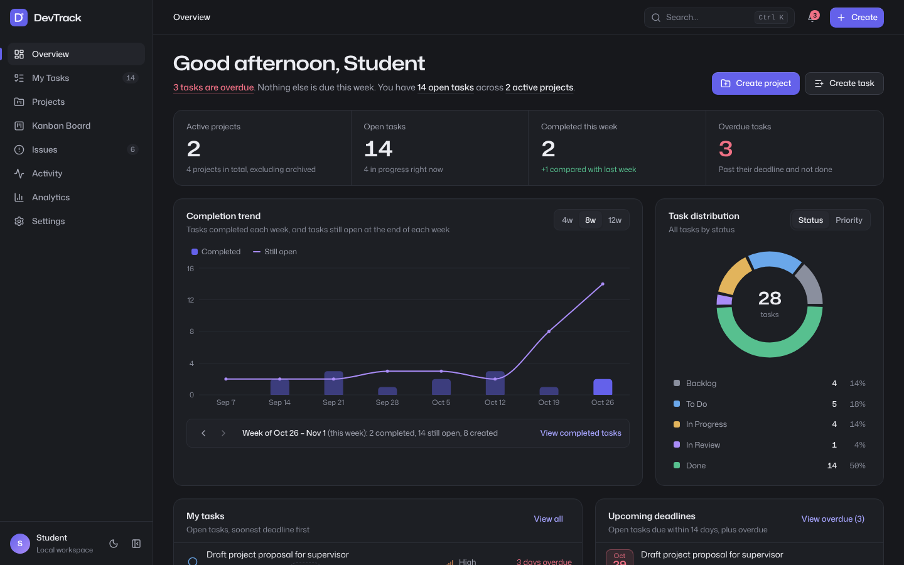
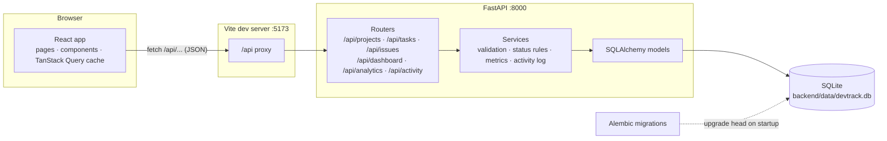
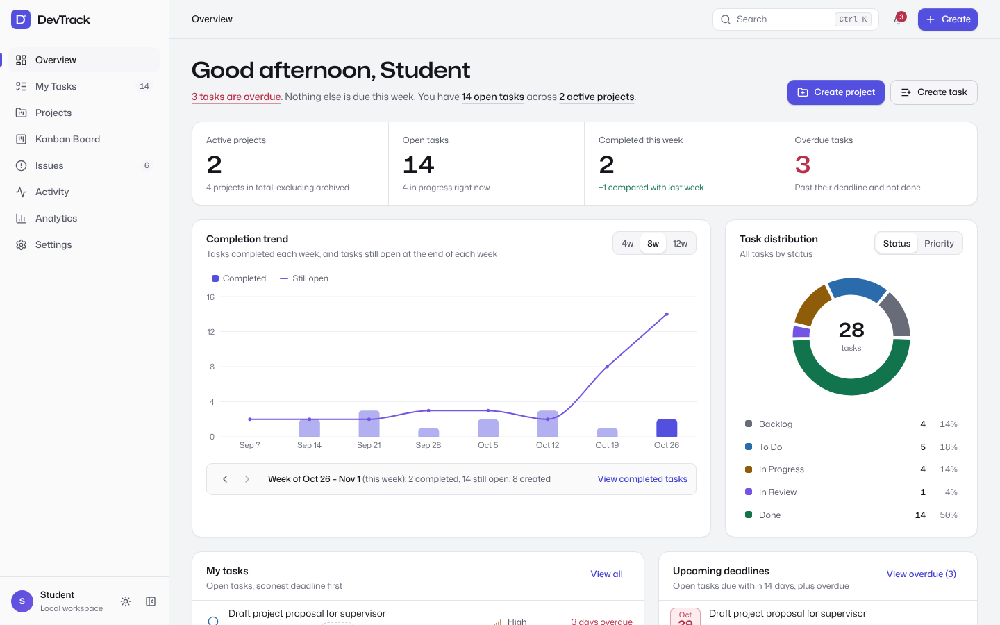
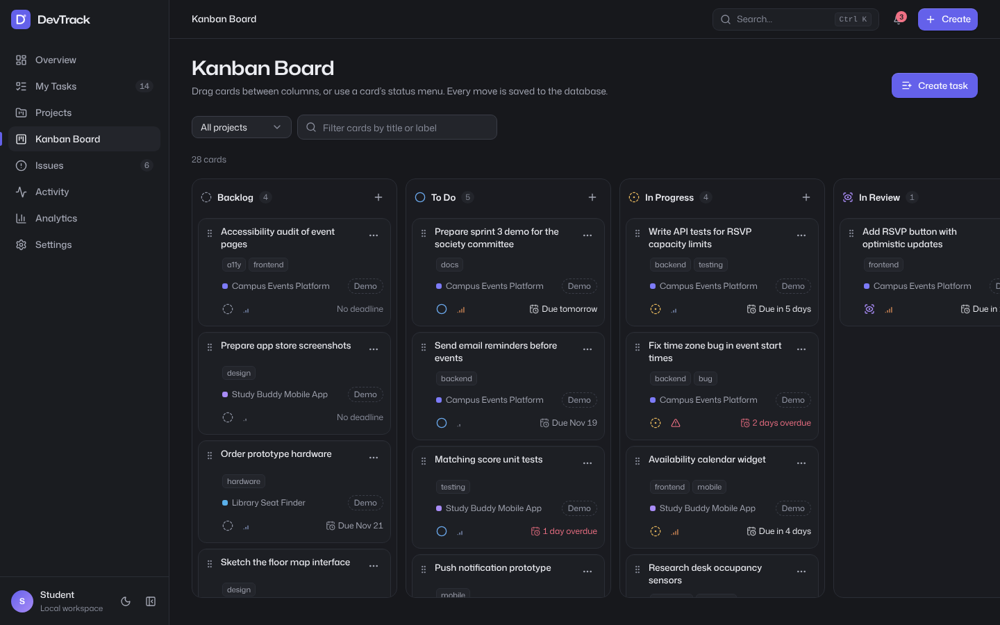
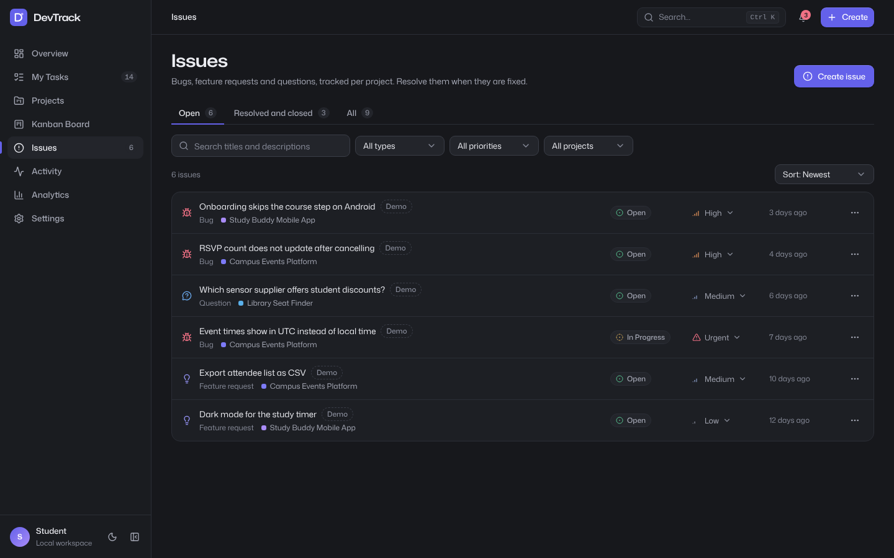
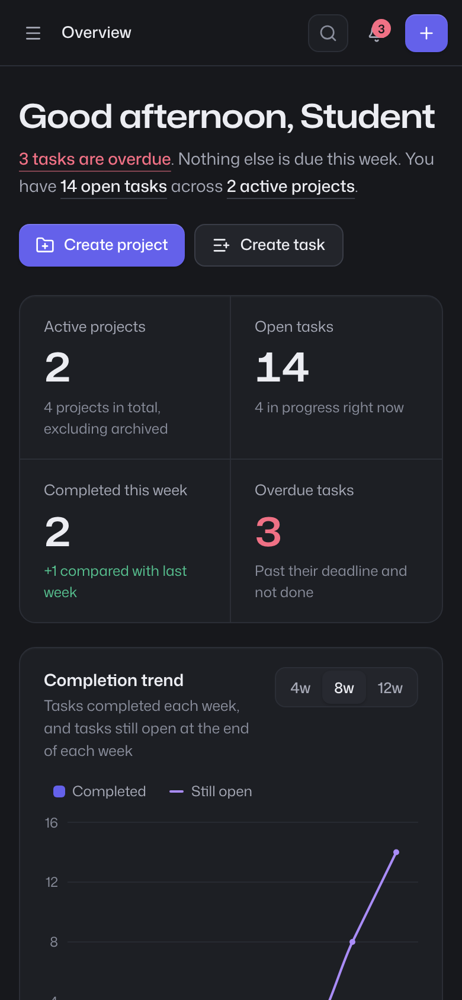

# DevTrack — Student Project & Issue Tracker

> Plan smarter. Build better. Ship together.

DevTrack is a full-stack project and issue tracker for students and small software teams. You
create projects, break them into tasks, move tasks across a Kanban board, report issues, and
watch progress on a dashboard whose every number is calculated from the records in the database.

It runs entirely on your own computer: a React + TypeScript frontend, a FastAPI backend and a
SQLite database file. No account, paid service or internet connection is needed after installing
the dependencies.



## Contents

- [Features](#features)
- [Tech stack](#tech-stack)
- [Architecture](#architecture)
- [Repository layout](#repository-layout)
- [Run it on Windows (PowerShell)](#run-it-on-windows-powershell)
- [Configuration](#configuration)
- [Database and demo data](#database-and-demo-data)
- [Testing](#testing)
- [API overview](#api-overview)
- [Git and GitHub workflow](#git-and-github-workflow)
- [Screenshots](#screenshots)
- [Known limitations](#known-limitations)
- [Future enhancements](#future-enhancements)
- [AI-assisted development](#ai-assisted-development)
- [License](#license)

## Features

**Overview dashboard**

- Greeting with your display name and a one-sentence summary of what is overdue and due this week.
- Four metrics from the database: active projects, open tasks, tasks completed this week and
  overdue tasks. Each one opens the matching filtered list, with the filter shown and removable.
- Weekly completion trend (4, 8 or 12 weeks) with tooltips, series toggles and week-by-week
  stepping; clicking a week opens the tasks completed that week.
- Task distribution by status or priority; legend entries and chart segments open the tasks they count.
- My tasks with inline status changes, upcoming deadlines with overdue tasks marked, project
  progress, and recent activity that links to the record it describes.

**Projects**: grid or table view, search, status filter, sorting, create, edit, archive and
restore, and delete with confirmation. Progress is calculated from each project's tasks, and
overdue projects are flagged. The project page shows task counts by status, tasks, issues and
the project's own activity.

**My Tasks**: search; filters for status, priority, project, deadline and label; sorting by
deadline, priority, creation date, last update or title; inline status changes and completion;
details drawer; edit and delete. Filters live in the URL, so a filtered list can be bookmarked.

**Kanban board**: five columns (Backlog, To Do, In Progress, In Review, Done). Drag cards with
a mouse or touch, or move them with the keyboard: Space on the handle, arrow keys, Space to drop
(Escape cancels). Each card also has a status menu. Every move is saved to the database and
undone if the server rejects it.

**Issues**: bugs, feature requests, improvements and questions per project, with priority and a
lifecycle (open, in progress, resolved, closed, reopened). Open, closed and all tabs; search,
filters and sorting; full change history in the details drawer.

**Activity**: a log written by the API in the same database transaction as each change, filterable
by type, project and text. Entries open the project, task or issue, and say so when it has since
been deleted.

**Analytics**: completion rate, weekly trend, tasks by status and priority, project progress,
issues by type and a completion calendar, for all projects or one. Every figure links to its records.

**Settings**: display name, theme (dark, light or follow the system), first day of the week (used
by every weekly figure), loading and removing the demo data, and a link to the API documentation.

**Everywhere**: a command palette (Ctrl K) that searches projects, tasks and issues; deadline
alerts; responsive layouts from phone to desktop; keyboard access and visible focus; loading,
empty and error states with a retry; and confirmation only after the server has saved a change.

There is no login: DevTrack is a single-user tool for a local workspace (see
[Known limitations](#known-limitations)).

## Tech stack

| Layer | Technology |
| --- | --- |
| Frontend | React 19, TypeScript (strict), Vite 8, Tailwind CSS 4, Radix UI primitives (shadcn/ui-style components), Lucide icons |
| Data and forms | TanStack Query 5, React Router 7, React Hook Form 7, Zod 4 |
| Charts and drag-and-drop | Recharts 3, dnd-kit |
| Backend | Python 3.13, FastAPI, Pydantic 2, SQLAlchemy 2, Alembic, Uvicorn |
| Database | SQLite (one file, foreign keys and check constraints enforced) |
| Tests | Pytest + HTTPX (API), Vitest + Testing Library (components), Playwright (end to end) |
| Quality | Ruff, ESLint, Prettier, TypeScript compiler, GitHub Actions |

## Architecture



What happens when you drag a card from **To Do** to **In Progress**:

1. The board moves the card immediately (optimistic update) and sends
   `PATCH /api/tasks/{id}` with the new status and position.
2. FastAPI validates the body with Pydantic. The task service applies the status rules (for
   example, setting `completed_at` when a task becomes Done) and writes an activity entry, both
   in one database transaction.
3. When the server confirms, the app shows "Moved to In Progress" and refreshes the dashboard,
   lists and charts that depend on tasks. If it fails, the card returns to its column and the
   error is shown.

Dates are calculated in your browser's time zone: the frontend sends it in an `X-Timezone`
header, so "due today" and "this week" mean the same thing in the API and on screen.

## Repository layout

```text
devtrack/
├── backend/
│   ├── app/
│   │   ├── main.py            FastAPI app factory, CORS, error handlers
│   │   ├── models.py          SQLAlchemy models and constraints
│   │   ├── routers/           HTTP endpoints
│   │   ├── services/          business rules, metrics, activity log, demo data
│   │   ├── schemas/           Pydantic request and response models
│   │   └── manage.py          init-db, seed-demo, remove-demo commands
│   ├── migrations/            Alembic environment and versions
│   ├── tests/                 Pytest suite (each test uses its own SQLite copy)
│   ├── requirements.txt
│   └── requirements-dev.txt
├── frontend/
│   ├── src/
│   │   ├── pages/             one file per screen
│   │   ├── components/        UI primitives, forms, charts, board, drawers
│   │   ├── hooks/             queries, mutations, URL state
│   │   ├── lib/               API client, dates, filters, labels
│   │   └── test/              Vitest setup, fixtures, fetch mock
│   ├── e2e/                   Playwright journeys and control sweep
│   ├── package.json
│   └── playwright.config.ts
├── docs/                      AI usage, exam demo script, QA report, screenshots
├── .github/                   CI workflow, issue and pull request templates
├── .env.example
├── CONTRIBUTING.md
└── LICENSE
```

## Run it on Windows (PowerShell)

### Prerequisites

| Tool | Version | Check with |
| --- | --- | --- |
| Python | 3.13 (3.12 also works) | `py -3.13 --version` |
| Node.js | 24 LTS (or 22.12 or newer) | `node --version` |
| Git | any recent version | `git --version` |

When installing Python from python.org, keep **"py launcher"** selected. If `py` is not available,
replace `py -3.13` below with `python`.

### 1. Get the code

```powershell
git clone https://github.com/<your-account>/devtrack.git
cd devtrack
```

### 2. Terminal 1: backend (API on port 8000)

```powershell
cd backend
py -3.13 -m venv .venv
.\.venv\Scripts\python -m pip install --upgrade pip
.\.venv\Scripts\python -m pip install -r requirements-dev.txt
.\.venv\Scripts\python -m uvicorn app.main:app --reload --port 8000
```

On first start the API creates `backend\data\devtrack.db`, applies the migrations and loads a
small demo workspace. Leave this terminal running. The interactive API documentation is at
<http://127.0.0.1:8000/docs>.

These commands call the virtual environment's Python directly, so you do not need to activate
it. If you prefer to activate it and PowerShell blocks `Activate.ps1`, run
`Set-ExecutionPolicy -Scope Process -ExecutionPolicy Bypass` first (this affects only the
current window).

### 3. Terminal 2: frontend (app on port 5173)

```powershell
cd frontend
npm ci
npm run dev
```

Open <http://localhost:5173>. Vite forwards every `/api` request to the backend on port 8000.

`npm ci` installs the exact versions from `package-lock.json`; `npm install` also works.

### Stopping and starting again

Press `Ctrl+C` in each terminal. Next time, run only the last command in each one:

```powershell
# Terminal 1, in backend
.\.venv\Scripts\python -m uvicorn app.main:app --reload --port 8000
# Terminal 2, in frontend
npm run dev
```

### Production build (optional)

```powershell
cd frontend
npm run build
npm run preview
```

`npm run preview` serves the built files on <http://localhost:4173> and still proxies `/api` to port 8000.

### Common problems

| Symptom | Fix |
| --- | --- |
| The app says "Cannot reach the DevTrack API" | Start the backend (terminal 1) and check <http://127.0.0.1:8000/api/health>. |
| `Port 5173 is already in use` | Close the other dev server, or run `npm run dev -- --port 5180`. |
| Port 8000 is in use | Start the API with `--port 8010` and set `VITE_API_PROXY_TARGET=http://127.0.0.1:8010` in `.env`, then restart `npm run dev`. |
| `py` is not recognised | Install Python with the py launcher, or use `python -m venv .venv`. |
| You want an empty workspace | Settings → Demo data → **Remove demo data**, or reset the database (below). |

## Configuration

Everything works without a configuration file. To change a setting, copy the example file in the
repository root and edit the copy:

```powershell
Copy-Item .env.example .env
```

| Variable | Default | Purpose |
| --- | --- | --- |
| `DEVTRACK_DATABASE_URL` | `sqlite:///./data/devtrack.db` | Database location. Relative paths are relative to `backend/`. |
| `DEVTRACK_CORS_ORIGINS` | `http://localhost:5173,http://127.0.0.1:5173` | Browser origins allowed to call the API directly. |
| `DEVTRACK_SEED_DEMO_DATA` | `true` | Load the demo workspace the first time the database is created. |
| `VITE_API_PROXY_TARGET` | `http://127.0.0.1:8000` | Where the Vite dev server forwards `/api` requests. |
| `VITE_API_BASE_URL` | empty | Set only if the frontend should call the API directly instead of through the proxy. |

`.env` is ignored by Git. `.env.example` contains no secrets, and none are needed.

## Database and demo data

- The schema is managed by Alembic. The API runs `alembic upgrade head` when it starts, so a
  fresh clone needs no extra step. You can also run it yourself:
  `.\.venv\Scripts\python -m app.manage init-db` (from `backend`).
- The demo workspace (4 projects, 28 tasks, 9 issues, marked **Demo**) is loaded once, the first
  time the database is created. Remove it in Settings or with
  `.\.venv\Scripts\python -m app.manage remove-demo`; load it again with
  `.\.venv\Scripts\python -m app.manage seed-demo` (add `--reset` to replace it).
  Removing demo data deletes the demo projects and everything in them; Settings tells you first
  if you added your own tasks or issues to a demo project. Projects you created are never touched.
- **Reset everything**: stop the backend, delete `backend\data\devtrack.db`, and start the backend again.
- Integrity rules are enforced by the database as well as the API: foreign keys with cascading
  deletes, unique project names (case-insensitive), valid statuses and priorities, deadlines not
  before start dates, and `completed_at` set exactly when a task is Done.

## Testing

All three suites use their own databases; none of them reads or changes `backend\data\devtrack.db`.

```powershell
# Backend: 68 API tests, each on a fresh copy of a migrated SQLite database
cd backend
.\.venv\Scripts\python -m pytest
.\.venv\Scripts\python -m ruff check .
.\.venv\Scripts\python -m ruff format --check .

# Frontend: type check, lint, formatting, component tests and production build
cd ..\frontend
npm run check

# End to end (Playwright). The first command downloads Chromium once.
npx playwright install chromium
npm run test:e2e
```

`npm run test:e2e` starts its own API on port 8001 with a temporary database (demo data off) and
its own Vite server on port 5174, then drives Chromium through the user journeys: projects,
tasks and the Kanban board, issues, search and filters, error handling, the dashboard checked
against the API, and a sweep of every remaining control. It needs the backend virtual
environment from step 2, and ports 8001 and 5174 must be free. To use your installed Chrome
instead of downloading Chromium, run `$env:PW_CHANNEL = "chrome"; npm run test:e2e`.

The measured results, the interaction inventory and the bugs found during QA are in
[docs/QA_REPORT.md](docs/QA_REPORT.md).

**Continuous integration**: [.github/workflows/ci.yml](.github/workflows/ci.yml) runs the
backend checks, the frontend checks and build, and the Playwright suite on every push to `main`
and every pull request.

## API overview

Base URL `http://127.0.0.1:8000/api`. Full, interactive documentation: `/docs` (Swagger UI) and `/redoc`.

| Resource | Endpoints |
| --- | --- |
| Health | `GET /health` |
| Projects | `GET /projects`, `POST /projects`, `GET /projects/{id}`, `PATCH /projects/{id}`, `DELETE /projects/{id}` |
| Tasks | `GET /tasks`, `POST /tasks`, `GET /tasks/{id}`, `PATCH /tasks/{id}`, `DELETE /tasks/{id}`, `GET /labels` |
| Issues | `GET /issues`, `GET /issues/summary`, `POST /issues`, `GET /issues/{id}`, `PATCH /issues/{id}`, `DELETE /issues/{id}` |
| Dashboard | `GET /dashboard/summary`, `GET /dashboard/completion-trend`, `GET /dashboard/task-distribution`, `GET /dashboard/upcoming-deadlines` |
| Analytics | `GET /analytics/overview` |
| Activity and search | `GET /activity`, `GET /search` |
| Settings | `GET /preferences`, `PATCH /preferences`, `GET /demo-data`, `POST /demo-data`, `DELETE /demo-data` |

Errors always have the same shape and never include stack traces. For example, `POST /tasks`
with an empty title and no project returns `422`:

```json
{
  "detail": "Title: This field cannot be empty. (1 more field to fix)",
  "code": "validation_error",
  "errors": [
    { "field": "title", "message": "This field cannot be empty." },
    { "field": "project_id", "message": "This field is required." }
  ]
}
```

## Git and GitHub workflow

The history was built the way a small team would work: each feature on its own branch, merged
into `main` with a merge commit (`git merge --no-ff`) so the branch structure stays visible.

```text
main ─┬─ feature/backend-api          data model, migration, REST API, API tests
      ├─ feature/frontend-shell       app shell, design system, typed API client
      ├─ feature/dashboard            dashboard backed by real metrics
      ├─ feature/project-management   projects list, detail page and CRUD
      ├─ feature/task-management      My Tasks and the Kanban board
      ├─ feature/issues-analytics     issues, activity, analytics and settings
      └─ test/documentation           Vitest and Playwright suites, CI, documentation, QA fixes
```

See the history with `git log --oneline --graph --all`. Commit messages follow
[Conventional Commits](https://www.conventionalcommits.org/) (`feat:`, `fix:`, `test:`, `docs:`, `ci:`).

After the repository is on GitHub, new work goes through pull requests: create a branch, push it,
open a pull request (the template asks what changed and how it was tested), let CI run, review,
then merge. Bugs and ideas go in issues using the templates in `.github/ISSUE_TEMPLATE`.
[CONTRIBUTING.md](CONTRIBUTING.md) has the step-by-step commands.

## Screenshots

| Light theme | Kanban board |
| --- | --- |
|  |  |

| Issues | Phone layout |
| --- | --- |
|  |  |

These were captured from the running app with the demo workspace. To update them, start both
servers, open the page, and save a browser screenshot (or use your operating system's
screenshot tool) to `docs/screenshots/` with the same file name.

## Known limitations

- **Single user, no authentication.** Anyone who can open the app on your computer can change
  the data. Do not expose the servers to a network.
- **SQLite** suits one user on one machine. Many simultaneous writers would need PostgreSQL or
  similar (SQLAlchemy and Alembic make that switch possible, but it has not been done).
- Tasks have no assignees or comments, and there are no notifications outside the app.
- The demo workspace's dates are relative to the day it is loaded.
- Automated tests run in Chromium only. Firefox, Safari and real touch devices were not tested,
  and the screen reader support (labels, live announcements) was checked in code and tests, not
  with an actual screen reader.
- The Windows PowerShell commands above follow standard Python and Node.js usage but were
  written and verified on Linux; see [docs/QA_REPORT.md](docs/QA_REPORT.md) for exactly what was run.

## Future enhancements

- Accounts and teams (sign-in, per-user task assignment, permissions).
- Comments and file attachments on tasks and issues.
- Sprints or milestones with burndown charts.
- Export to CSV and import from GitHub Issues.
- PostgreSQL and a containerised deployment.

## AI-assisted development

This project was built with the help of an AI coding assistant. What it did, how its output was
checked, and how to use such tools responsibly are described in [docs/AI_USAGE.md](docs/AI_USAGE.md).
The application itself contains no AI features and sends no data to any external service.

## License

[MIT](LICENSE)
